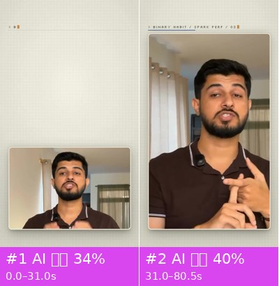
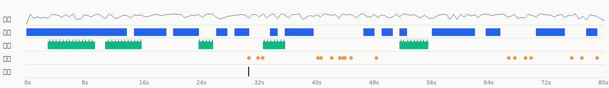
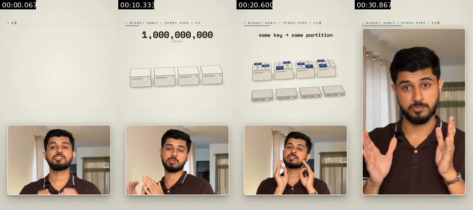
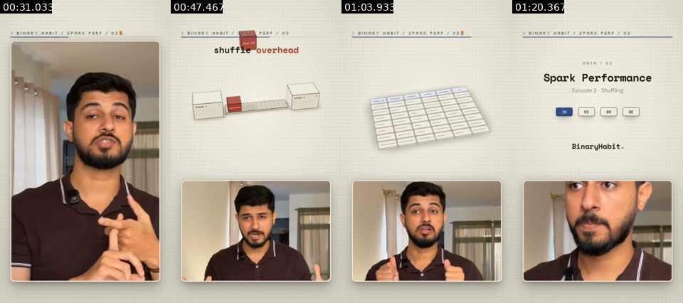

# Video breakdown: e921ed02-shuffle.mp4

**Verdict**: Mixed production: AI-generated video 100%; overlays: static graphics (composited in code / an editor); audio: voice + music 132.5BPM (stock library music) + 18 sound effects

- 80.467s · 1080×1920 · 30.0fps · 9:16; 2 shots, 40.23s average; transitions: jump cut×1
- Confidence (duration-weighted) 38%; decided by: deterministic forensics + agent image review; Claude reviewed 2/2 shots by eye; merged into the verdict
- Remake: 2 AI video shots → 2 generation units, 4 Seedance 2.5 calls (see “Remake plan”)
- ⚠️ 3 open questions, see “Open questions” first: Shot #1 (0.0–31.0s): Tools say AI-generated video, the image review says live ac…

<!--mix-->

| Base picture | Duration | Share |
|---|---|---|
| AI-generated video | 80.47s | 100% |



## Content and structure

- No whole-video summary (needs the VLM or an agent watching the full video); subtitle text is under “Packaging layer”

## Cast, scenes and props

For the remake, give every character one reference image (`@image`) used across all generation units and copy the look below into the first-frame prompts, so the character stays the same from shot to shot.

| Id | Name | Kind | Look | Role | Voice | Shots |
|---|---|---|---|---|---|---|
| A | presenter | other | man with dark hair and beard, dark brown polo shirt, lavalier mic | host | his own voice | — |

**Scenes**

| Scene | Where | When | Set / light | Shots |
|---|---|---|---|---|
| S1 | living room by a window | daytime | curtains, plants, warm lamps | — |

## Sound



- loudness -16.4 dBFS, peak -4.2 dBFS
- Sources: Video type: voice-over / talking head + music → voice: TTS voice-over (leaning, to confirm); music: stock library music; SFX: added in post from an SFX library / editor (leaning, to confirm)

**Voice**

- 60% of the duration; pitch about 154.2Hz (gender unclear); sung
- Source: to confirm (tts 43%, human_recording 43%, ai_video_native 14%)
- Remake: capsule-cinema DoubaoTTSTool / UniversalTTSTool (or a MiniMax cloned voice); use duration-controlled TTS when it must fit the original time window

**Music**

- Tempo: 132.5 BPM (or 66.3/265.0); key D minor (confidence 0.795); 26% of the duration (3.0–56.0s); section changes at 8.5s, 15.5s, 23.5s, 29.5s, 53.5s, 57.5s, 64.5s, 73.5s; ending: ends_early
- Cuts vs beat: 0% of cuts land on a beat (chance: about 8%)
- Source: stock library music (existing_library 60%, ai_generated 20%, popular_song 20%)
  - The music is a bed under the picture: in a regular video the bed usually comes from a stock library (prior)
  - How to confirm: Check the music tag on the original Douyin / Xiaohongshu / TikTok post: a song title → existing track; "original sound - @creator" → uploaded by the creator (for music videos, usually an AI song)
  - How to confirm: Run it through Shazam / ACRCloud or another song-ID service: a hit means an existing song
- Remake: The original track leans stock library music: search a library by BPM / mood / key for a similar track, or generate a royalty-free track in a similar style with AI

**Sound effects** (18)

<details><summary>all 18 sound effects</summary>

| Time | Type | Description | On screen | Basis |
|---|---|---|---|---|
| 31.01s | pop | — | cut | signal candidate (low confidence) |
| 32.26s | ding | — | — | signal candidate (low confidence) |
| 32.91s | pop | — | — | signal candidate (low confidence) |
| 40.62s | pop | — | — | signal candidate (low confidence) |
| 41.05s | pop | — | — | signal candidate (low confidence) |
| 42.50s | whoosh | — | — | signal candidate (low confidence) |
| 43.69s | pop | — | — | signal candidate (low confidence) |
| 44.08s | pop | — | — | signal candidate (low confidence) |
| 44.34s | pop | — | — | signal candidate (low confidence) |
| 45.20s | pop | — | — | signal candidate (low confidence) |
| 48.75s | whoosh | — | — | signal candidate (low confidence) |
| 67.22s | pop | — | — | signal candidate (low confidence) |
| 68.02s | pop | — | — | signal candidate (low confidence) |
| 69.54s | pop | — | — | signal candidate (low confidence) |
| 70.31s | ding | — | — | signal candidate (low confidence) |
| 76.00s | whoosh | — | — | signal candidate (low confidence) |
| 77.38s | pop | — | — | signal candidate (low confidence) |
| 79.52s | pop | — | — | signal candidate (low confidence) |

</details>

- Source: added in post from an SFX library / editor (library_editor 57%, ai_native 29%, live_sync 14%)
- Remake: Place by timestamp: capsule-cinema SoundEffectsTool / an SFX library, or synthesise procedurally like the plush recipe (pitched to the music key)

- Separated stems: `stems/original.wav` (original), `stems/vocals.wav` (dry voice; transient sound effects land here too), `stems/music.wav` (music + ambience)
<!--stems-->

## Camera, lighting and editing

- Visual style: cream grid paper background, monospace header, rounded video card
- Framing: shot size medium close-up 100%; subject is a face (shot size from face height)
- Camera: fixed camera (tripod / mount / on the desk) 62%, handheld 38%
- Lighting: backlit / background brighter than subject. Key light frontal (from the camera side; both sides of the subject about equally bright), at subject height; lighting ratio about 1.3:1 (0.3 stops); soft light (wide lit-to-shadow ramp); colour temperature warm (about 3000–4000K); subject and background differ in colour temperature: mixed sources (e.g. warm lamp + cool window light / screen); background sharp
- (not live footage: the above describes the light in the picture, for generation prompts, not a shooting plan)
- Grade: natural (close to the original colours); low saturation, normal contrast, normal blacks, overall neutral
- Editing: 0.7 cuts per minute, 40.23s average shot; no live-action shots

<details><summary>Per-item measurements and image readings (9)</summary>

| Aspect | Item | Verdict | Sources |
|---|---|---|---|
| Framing | shot size | medium close-up | measured |
| Camera | camera support | mixed: fixed camera (tripod / mount / on the desk) 62%, handheld 38% | measured |
| Camera | set-ups / locations | one fixed phone on a tripod, chest-up, eye level | agent review |
| Camera | likely gear | smartphone, clip-on lavalier mic (visible on the collar) | agent review |
| Lighting | soft / hard | soft light (wide lit-to-shadow ramp) | measured |
| Lighting | colour temperature | warm (about 3000–4000K) | measured |
| Lighting | overall lighting | soft daylight from a window behind and to the side, room lights warm | agent review |
| Grade | colour grade | natural (close to the original colours) | measured |
| Grade | overall grade | natural, slightly low saturation | agent review |

</details>

- Note: lighting ratio, soft / hard, colour temperature and shot size are measured on the subject's pixels (the face when there is one, otherwise the in-focus region, which is an estimate); platform transcodes crush the shadows, so hardness and fill read conservative; camera angle, light source, catchlight and rim light follow the image readers. Where measurement and readers disagree, both are listed.

## Packaging layer (subtitles / styled text / stickers / sound-effect hits)

- SFX hits on: cut ×1
- No overlaid text or stickers detected
- Exports: `packaging/timeline.json` (SRT is the subtitle timeline; ASS carries colour, outline, position and entrance animation, swap in the original font; timeline.json is the full timeline)

Remake: burn subtitles and styled text in with `packaging/overlays.ass` (ffmpeg -vf ass=overlays.ass), or rebuild them from timeline.json in CapCut / Remotion; stickers and GIFs need matching assets (meme / GIF libraries), crops are under packaging/.

## Remake plan

**2 AI video shots → 2 generation units, 4 Seedance 2.5 calls**

- The default engine Seedance 2.0（含 Mini / Fast） cannot generate several shots in one call; with it you would generate shot by shot, 2 times. This plan is for Seedance 2.5 (≤30s per call, multi-shot in one call), 4 calls in total
- Grouping: AI shots in the same scene joined by hard cuts are generated in one call; ≤30s per call; consecutive hard cuts inside a unit preferably ≤8s, at most 10s; split at dissolves / fades and scene changes
- Audio: the model can generate action sound effects and ambience along with the picture; voice-over is better done as separate TTS and mixed in, so copy and timing stay editable

### Generation units

| Unit | Shots | Time | Duration | Mode | Continuity |
|---|---|---|---|---|---|
| G1 | #1 | 0.0–31.0s | 31.0s | long shot, split (2 calls) | first frame: generate an image matching the composition of source shot 1's first frame (shots/shot_001_first.jpg) |
| G2 | #2 | 31.0–80.5s | 49.5s | long shot, split (2 calls) | first frame = last frame of G1, continue the action |

**G1 · AI-generated video · shots #1 · 31.0s**

- References: `@图片1` character reference images (one frontal face + one half-body per character) so the look stays consistent across shots; `@视频1` source clip 0.0–31.0s: reference for action, camera movement and cutting rhythm (reference only, do not copy the picture)
- Single shot of 31.0s exceeds the Seedance 2.5 per-call limit of 30s: split into 2 parts at pauses in the action, each part starting from the previous part's last frame (S02)

```text
Vertical 9:16; backlit / background brighter than subject, soft light (almost no lit / shadow edge), warm (about 3000–4000K), background sharp. Characters follow @图片1. Follow the action, camera movement and cutting rhythm of @视频1.
A presenter talking to camera, filmed for real, shown in a small rounded card at the bottom of a cream grid page laid out in code; the top of the frame holds a 'binary habit' header and space for animated diagrams.
```

<details><summary>English prompt</summary>

```text
Not for AI: film the talking head on a phone on a tripod by a window, then place it in an HTML/Remotion layout.
```

</details>

**G2 · AI-generated video · shots #2 · 49.5s**

- References: `@图片1` character reference images (one frontal face + one half-body per character) so the look stays consistent across shots; `@视频1` source clip 31.0–80.5s: reference for action, camera movement and cutting rhythm (reference only, do not copy the picture)
- Single shot of 49.5s exceeds the Seedance 2.5 per-call limit of 30s: split into 2 parts at pauses in the action, each part starting from the previous part's last frame (S02)

```text
Vertical 9:16; backlit / background brighter than subject, soft light (almost no lit / shadow edge), warm (about 3000–4000K), background sharp. Characters follow @图片1. Follow the action, camera movement and cutting rhythm of @视频1.
The same presenter, larger card filling most of the frame, header 'BINARY HABIT / SPARK PERF / 03'; he counts on his fingers while explaining.
```

<details><summary>English prompt</summary>

```text
Not for AI: film the talking head on a phone on a tripod by a window, then place it in an HTML/Remotion layout.
```

</details>

## Shot list

| # | Time | Length | Base picture | Material | Overlays | Camera | Picture | Remake |
|---|---|---|---|---|---|---|---|---|
| 1 | 00:00.000 | 30.97s | AI-generated video 34% | AI-generated | — | handheld shake | A presenter talking to camera, filmed fo… | AI generation (first / last frame) · G1 |
| 2 | 00:30.967 | 49.50s | AI-generated video 40% | AI-generated | graphic | static (subject moves) | The same presenter, larger card filling … | AI generation (first / last frame) · G2 |

## Open questions

- Shot #1 (0.0–31.0s): Tools say AI-generated video, the image review says live action; on the AI / live-action axis the fusion follows the tools (eval-calibrated): check the frames to see whether the review's evidence is really visible
- Shot #2 (31.0–80.5s): Tools say AI-generated video, the image review says live action; on the AI / live-action axis the fusion follows the tools (eval-calibrated): check the frames to see whether the review's evidence is really visible
- voice source to confirm: leaning to confirm (43%)

## Appendix

### Shot by shot

Evidence, probabilities, text tracks and prompts per shot. Folded by default.

<details><summary>#1 00:00.000–00:30.967 · AI-generated video</summary>



- Probabilities: AI-generated video 34%, 3D render 30%, live action 15%（fused_agent）
- ⚠️ Disputed: Tools say AI-generated video, the image review says live action; on the AI / live-action axis the fusion follows the tools (eval-calibrated): check the frames to see whether the review's evidence is really visible
- Material: AI-generated
- [Claude review] natural skin texture, consistent hands and fingers across frames
- [Claude review] real room with curtains and furniture, real window light
- [Claude review] text and grid are crisp vector graphics, typical of an HTML/Remotion layout
- Picture: A presenter talking to camera, filmed for real, shown in a small rounded card at the bottom of a cream grid page laid out in code; the top of the frame holds a 'binary habit' header and space for animated diagrams.
- Camera / lighting: medium close-up; handheld; backlit / background brighter than subject; key light frame right, three-quarter front; lighting ratio about 1.4:1 (0.5 stops); soft light (wide lit-to-shadow ramp)
- Remake: Source is AI-generated: use the shot's first and last frames for first/last-frame generation to closely match composition and motion; to change the subject, edit the first frame with an image model first
  - Video prompt: A presenter talking to camera, filmed for real, shown in a small rounded card at the bottom of a cream grid page laid out in code; the top of the frame holds a 'binary habit' header and space for animated diagrams.

</details>

<details><summary>#2 00:30.967–01:20.467 · AI-generated video + code / editor overlays (static graphics)</summary>



- Probabilities: AI-generated video 40%, 3D render 26%, AI avatar (talking head) 16%（fused_agent）
- ⚠️ Disputed: Tools say AI-generated video, the image review says live action; on the AI / live-action axis the fusion follows the tools (eval-calibrated): check the frames to see whether the review's evidence is really visible
- Material: AI-generated
- Photographic texture: noise σ=0.16, 79 colours, 6% flat blocks
- 100% of sampled frames show a frontal face on a fixed camera, voice on the audio track
- [Claude review] natural skin texture, consistent hands and fingers across frames
- [Claude review] real room with curtains and furniture, real window light
- [Claude review] text and grid are crisp vector graphics, typical of an HTML/Remotion layout
- Picture: The same presenter, larger card filling most of the frame, header 'BINARY HABIT / SPARK PERF / 03'; he counts on his fingers while explaining.
- Camera / lighting: medium close-up; fixed camera (tripod / mount / on the desk); backlit / background brighter than subject; key light frontal (from the camera side; both sides of the subject about equally bright); lighting ratio about 1.3:1 (0.3 stops); soft light (almost no lit / shadow edge)
- Remake: Source is AI-generated: use the shot's first and last frames for first/last-frame generation to closely match composition and motion; to change the subject, edit the first frame with an image model first
  - Video prompt: The same presenter, larger card filling most of the frame, header 'BINARY HABIT / SPARK PERF / 03'; he counts on his fingers while explaining.

</details>

### Metadata clues

- Encoder: `Lavf62.12.102`

### Notes

- Deterministic forensics is reliable on motion, whole-frame pan/zoom, rendered texture and 24→30 fps conversion; telling live action from AI from 3D relies on the VLM and human review.
- Platform transcoding usually strips metadata; missing metadata proves nothing.
- The full data is in `breakdown.json`; agents read the compact view with `rea-video summary`.
